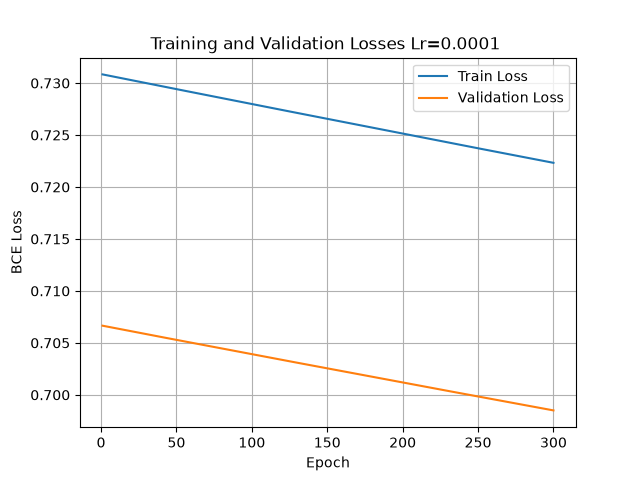
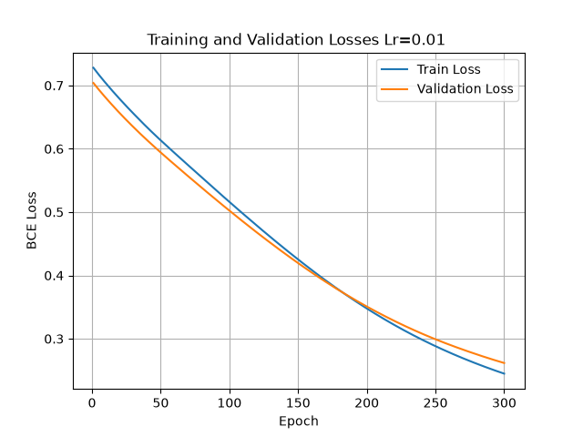
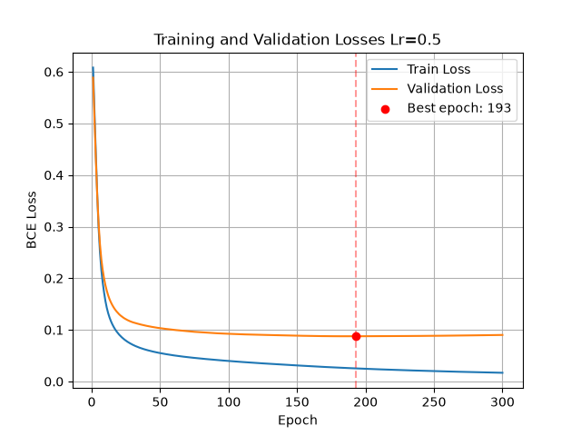
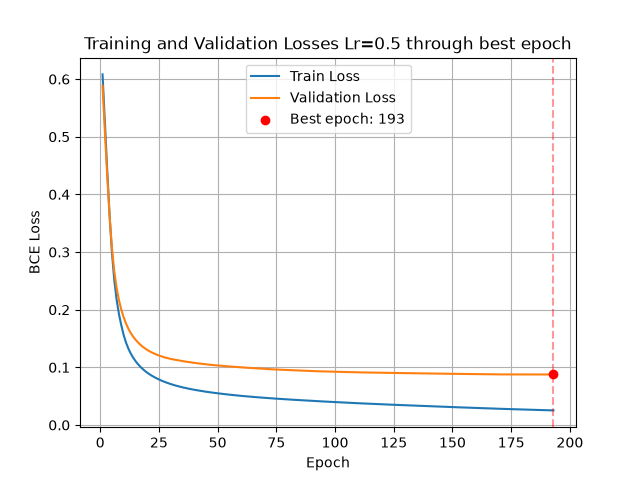

# Investigating Training Problems in a PyTorch Binary Classifier

**Dataset:** Breast Cancer Wisconsin (Diagnostic)  
**Task:** Binary classification  
**Frameworks:** PyTorch, scikit-learn, Matplotlib  
**Model:** Multilayer Perceptron (MLP)  
**Experiment:** Learning-rate comparison and early stopping

## 1. Objective

The objective of this laboratory exercise was to implement a multilayer binary classifier and investigate problems that can occur during model training. Specifically, the work included:

1. Preparing separate training, validation, and test sets.
2. Building a simple majority-class baseline.
3. Training an MLP using PyTorch.
4. Comparing three training configurations while varying **one factor: learning rate**.
5. Identifying insufficient learning and signs of overfitting from training/validation loss curves.
6. Evaluating ways to mitigate these problems.
7. Selecting the final checkpoint using validation data and evaluating it once on a held-out test set.

## 2. Dataset and preprocessing

The **Breast Cancer Wisconsin (Diagnostic)** dataset was loaded using `sklearn.datasets.load_breast_cancer()`. It is a copy of the UCI dataset distributed with scikit-learn. Each sample represents a breast mass described by numerical measurements of cell nuclei from a digitized fine-needle aspirate (FNA) image. The classification task is to distinguish malignant from benign masses; the model receives extracted measurements rather than raw images.

| Property | Value |
|---|---|
| Total samples | 569 |
| Numerical input features | 30 |
| Target classes | 2 |
| Class `0` | Malignant (cancerous): 212 samples, approximately 37.3% |
| Class `1` | Benign (non-cancerous): 357 samples, approximately 62.7% |
| Missing feature values | None |
| Training samples | 341 |
| Validation samples | 113 |
| Test samples | 115 |

### 2.1 Input features

The 30 inputs are derived from the following 10 measurements of cell nuclei:

| Measurement | Description |
|---|---|
| Radius | Mean distance from the nucleus center to points on its boundary |
| Texture | Standard deviation of grayscale values |
| Perimeter | Length of the nucleus boundary |
| Area | Area of the nucleus |
| Smoothness | Local variation in radius lengths |
| Compactness | Shape measure calculated as perimeter squared divided by area, minus 1 |
| Concavity | Severity of inward-curving portions of the boundary |
| Concave points | Number of inward-curving portions of the boundary |
| Symmetry | Symmetry of the nucleus shape |
| Fractal dimension | Measure of boundary complexity |

For each measurement, the dataset contains its **mean**, **standard error**, and **worst value**, where the worst value is the mean of the three largest values. This gives **10 measurements × 3 summaries = 30 numerical features**. For example, radius contributes mean radius, radius error, and worst radius. The diagnosis is the target label and is not included among the input features.

Dataset reference: [scikit-learn dataset documentation](https://scikit-learn.org/stable/datasets/toy_dataset.html#breast-cancer-dataset). The description and class counts were also checked against the dataset metadata bundled with the project's installed scikit-learn package.

### 2.2 Splitting and preprocessing

The dataset was split using the project's `train_val_test_split` helper. It shuffles sample indices with `np.random.default_rng(seed=42)` and assigns approximately **60% to training, 20% to validation, and 20% to testing**. The training and validation sizes are rounded down, and all remaining samples form the test set, giving 341, 113, and 115 samples respectively. The split is **random and non-stratified**, so class proportions are not explicitly preserved. The same split was used for all learning-rate configurations within the experiment.

**Feature standardization** was performed with `StandardScaler`. The scaler was fitted on training data only and then applied to validation and test features:

```python
scaler = StandardScaler()
X_train = scaler.fit_transform(X_train)
X_val = scaler.transform(X_val)
X_test = scaler.transform(X_test)
```

This scales each feature using its training-set mean and standard deviation, preventing validation/test statistics from leaking into preprocessing. Input features and binary targets were converted to PyTorch tensors with `dtype=torch.float32`.

## 3. Baseline and neural-network architecture

### 3.1 Majority-class baseline

The baseline predicts the most frequent class found in **training labels** for every validation sample. In this dataset, the majority training class was `1` (benign). This simple method provides a minimum reference against which to judge the neural network.

The correct procedure is to infer the majority from `y_train`, and then generate predictions for `len(y_val)` samples. The initial code used `y_val` to determine the majority; this should be corrected to avoid using validation labels to build the baseline.

### 3.2 Multilayer Perceptron

The implemented classifier used the architecture:

```text
30 input features → Linear(30, 16) → ReLU → Linear(16, 1) → 1 logit
```

The final layer returns a **raw logit**, not a probability. The logit is passed directly to `nn.BCEWithLogitsLoss`, which performs numerically stable binary cross-entropy with the sigmoid transformation internally. For classification, sigmoid is applied to the logit and a threshold of `0.5` determines the predicted label.

| Training setting | Value |
|---|---|
| Loss function | `nn.BCEWithLogitsLoss()` |
| Optimizer | `torch.optim.SGD` |
| Training type | Full-batch (one parameter update per epoch) |
| Epoch budget | 300 |
| Hidden layer | 16 neurons |
| Hidden activation | ReLU |
| Compared learning rates | `0.0001`, `0.01`, `0.5` |
| Weight initialization | PyTorch seed set to `42` before each model was created |

Each configuration used the same architecture, processed dataset, number of epochs, and initial random seed; **learning rate was the chosen experimental variable**. Model parameters were updated **only using training-set loss**. Validation loss was measured after each epoch without backpropagation or optimizer updates.

## 4. Evaluation measures

The binary confusion matrix is interpreted as follows (with class `1` treated as the positive class):

| | Predicted `0` | Predicted `1` |
|---|---:|---:|
| Actual `0` | TN | FP |
| Actual `1` | FN | TP |

The reported metrics are:

- **Accuracy:** `(TP + TN) / (TP + TN + FP + FN)`.
- **Precision (class 1):** `TP / (TP + FP)`.
- **Recall (class 1):** `TP / (TP + FN)`.
- **F1-score (class 1):** `2 TP / (2 TP + FP + FN)`.
- **Binary cross-entropy loss:** used to assess the quality and confidence of probabilistic predictions over training and validation sets.

**Clinical interpretation matters:** because class `0` is *malignant*, the number of malignant samples misclassified as benign is represented by **FP** under this class-`1`-positive convention. Recall for the malignant class is `TN / (TN + FP)`.

## 5. Baseline and learning-rate experiments

Three models were trained for 300 epochs each. The following results were obtained on the **same validation set (113 samples)**. Values are calculated from the recorded confusion matrices; all classification metrics use class `1` as positive.

| Configuration | TP | TN | FP | FN | Accuracy | Precision | Recall | F1 |
|---|---:|---:|---:|---:|---:|---:|---:|---:|
| Majority baseline | 76 | 0 | 37 | 0 | 67.26% | 67.26% | 100.00% | 80.42% |
| SGD, LR = 0.0001 | 58 | 4 | 33 | 18 | 54.87% | 63.74% | 76.32% | 69.46% |
| SGD, LR = 0.01 | 73 | 33 | 4 | 3 | 93.81% | 94.81% | 96.05% | 95.42% |
| SGD, LR = 0.5 (epoch 300) | 76 | 36 | 1 | 0 | **99.12%** | **98.70%** | **100.00%** | **99.35%** |

> **Baseline correction:** An earlier console output displayed `FP = 0, FN = 37` because the inputs to the custom confusion-matrix helper were reversed. For a classifier that always predicts class `1`, with 76 actual class-`1` samples and 37 actual class-`0` samples, the correctly ordered result is `TP = 76, TN = 0, FP = 37, FN = 0`.

### 5.1 Learning rate = 0.0001: insufficient learning



*Figure 1. LR = 0.0001: both losses decrease only slightly, indicating slow learning within the epoch budget.*

Both training and validation losses decreased only slightly during 300 epochs and remained close to 0.7. Validation accuracy was **54.87%**, below the majority baseline's **67.26%**. The optimizer's updates were too small for effective convergence within the given training budget.

**Problem identified:** insufficient learning / underfitting within the specified epoch budget. This does not prove that the model architecture is incapable of solving the task; with substantially more training, a small learning rate might eventually converge.

**Mitigation:** increasing learning rate to `0.01` raised validation accuracy to **93.81%**, and increasing it to `0.5` raised validation accuracy to **99.12%**.

### 5.2 Learning rate = 0.01: stable, gradual convergence



*Figure 2. LR = 0.01: training and validation losses decrease smoothly and remain close.*

Both loss curves decreased smoothly through the 300-epoch budget. Validation loss remained close to training loss and did not turn upward. The network reached **93.81% validation accuracy**, indicating successful learning with no clear signs of overfitting within the observed interval. The curves had not completely flattened by epoch 300, so training might have continued to improve with additional epochs.

### 5.3 Learning rate = 0.5: rapid learning with mild late overfitting



*Figure 3. LR = 0.5: validation loss reaches its minimum at epoch 193, then rises slightly as training loss continues to fall.*

This setting reduced training and validation loss much faster than the lower learning rates. It did **not** produce oscillations or exploding losses; therefore, this experiment does not demonstrate unstable training at LR `0.5`.

Validation loss reached its minimum at **epoch 193** and then increased slightly while training loss continued to decrease. This is evidence of **mild late-stage overfitting**: continuing to fit the training samples no longer improved validation cross-entropy. The effect was small rather than a major deterioration of classification accuracy.

## 6. Overfitting mitigation: best validation checkpoint / early stopping

To address the late increase in validation loss for the LR `0.5` configuration, the training procedure tracked the best validation loss and saved a deep copy of the corresponding model parameters. This is a **best-checkpoint selection approach based on validation performance** (an early-stopping-style remedy); training still ran to epoch 300 so that both outcomes could be compared.



*Figure 4. Loss curves through epoch 193, the checkpoint selected by minimum validation loss.*

| Comparison | Selected checkpoint (epoch 193) | Last checkpoint (epoch 300) |
|---|---:|---:|
| Validation BCE loss | **0.08761768** | 0.09011792 |
| Validation accuracy | 99.12% | 99.12% |
| Correct validation predictions | 112 / 113 | 112 / 113 |

The best checkpoint reduced validation loss by approximately **2.77% relative to the final checkpoint**, despite producing the same binary class predictions at the `0.5` decision threshold. This is possible because cross-entropy is sensitive to prediction confidence, while accuracy only checks the resulting class label.

**Interpretation:** retaining the earlier checkpoint modestly improved probabilistic generalization on validation data. It did **not** improve validation accuracy, and the observed overfitting was limited. Claims of substantial overfitting or major gains from regularization would not be supported by these results.

The chosen checkpoint (LR `0.5`, epoch `193`) was saved as `best_model_lr_0_5.pt`.

## 7. Final selection and held-out test evaluation

Based on the validation experiments, the selected model was:

| Parameter | Selected value |
|---|---|
| Architecture | `30 → 16 → 1` |
| Activation | ReLU |
| Loss | BCEWithLogitsLoss |
| Optimizer | SGD |
| Learning rate | **0.5** |
| Selected epoch | **193** |
| Selection criterion | Minimum validation BCE loss |

After selection, the saved checkpoint was loaded into a newly instantiated MLP and evaluated on the **held-out test set of 115 samples**. Test data had not been used for gradient updates or for choosing the learning rate/epoch.

### 7.1 Test confusion matrix

| | Predicted malignant (`0`) | Predicted benign (`1`) |
|---|---:|---:|
| **Actual malignant (`0`)** | **42 (TN)** | **0 (FP)** |
| **Actual benign (`1`)** | **1 (FN)** | **72 (TP)** |

### 7.2 Test performance

| Metric | Result |
|---|---:|
| Correct classifications | **114 / 115** |
| Accuracy | **99.13%** |
| Precision (benign, class 1) | **100.00%** |
| Recall (benign, class 1) | **98.63%** |
| F1-score (benign, class 1) | **99.31%** |
| Recall (malignant, class 0) | **100.00% (42 / 42)** |

The model made **one test-set classification error**: one benign case was predicted as malignant. In this particular test split, no malignant case was predicted as benign.

## 8. Discussion and limitations

The experimental evidence supports these conclusions:

1. **Learning-rate selection had a large effect on convergence.** With LR `0.0001`, the model learned too slowly for the 300-epoch budget; increasing LR improved validation performance substantially.
2. **LR `0.01` gave smooth, stable training**, but converged more slowly than LR `0.5` under the same budget.
3. **LR `0.5` was stable in this run**, despite being comparatively large. It delivered the best validation classification results and the lowest validation cross-entropy of the configurations tested.
4. **A small late-stage overfitting effect was observed** after epoch 193. Using the best checkpoint improved validation BCE loss but not validation classification accuracy.
5. **The selected model generalized well to the held-out test set**, achieving 99.13% accuracy and 99.31% F1 for class `1`.


## 9. Conclusion

A PyTorch multilayer perceptron was trained to classify Breast Cancer Wisconsin samples. The experiment included a majority-class baseline, three learning-rate configurations, monitoring of training and validation loss, and selection of the checkpoint with the lowest validation loss.

Two training-related issues were investigated: **insufficient learning caused by a very small learning rate** and **mild late-stage overfitting from continued optimization**. The first was mitigated by increasing the learning rate. The second was mitigated modestly by retaining the model weights from epoch 193 rather than epoch 300.

The final selected model—**SGD with learning rate 0.5, 16 hidden ReLU units, and weights from epoch 193**—achieved **99.13% accuracy, 100.00% precision, 98.63% recall, and 99.31% F1-score** on the held-out test set for the positive label `1` (benign). The experiment illustrates why validation curves, appropriate baselines, and held-out test evaluation are necessary when assessing neural-network training.
